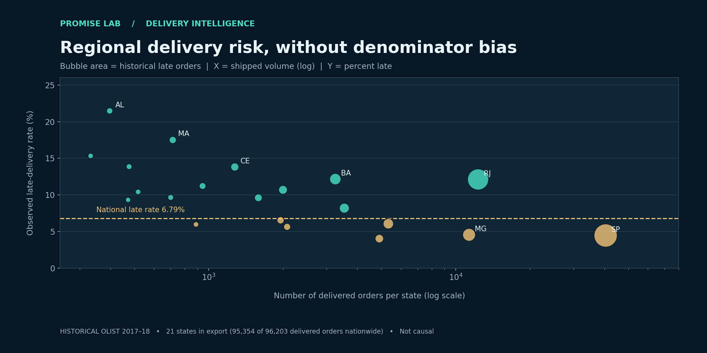

# OLIST COMMERCE INTELLIGENCE

### Delivery Promise Lab — a decision-focused Data Analyst portfolio extension

**Built for:** Nguyễn Quốc Anh · **Focus:** E-commerce / Operations Analytics / Decision Support  
**Skills:** SQL (DuckDB), Python (Pandas, NumPy), data validation, statistical uncertainty, KPI analytics, Power BI/DAX, interactive dashboarding, scenario modeling, GitHub Actions.

> **Attribution first:** This project extends an existing Olist analytics repository by [TobyTY](https://github.com/TobyTY/ecommerce-analytics-olist), whose original code and results are retained. See [NOTICE.md](NOTICE.md) and [the preserved upstream README](docs/source_project_README.md). The new work is the **Delivery Promise Lab** feature, implemented with AI assistance and intended for further review and customization by the portfolio owner.

## Start here

**[Open the interactive Delivery Promise Lab](promise_lab/index.html)** — download/clone the repository and open the HTML file in a modern browser. It is self-contained, works offline, and does not require a database connection. GitHub Pages serves the same page from `docs/index.html` when Pages is configured to deploy the `docs/` folder.



**Other views:** [Original full e-commerce dashboard](dashboard/index.html) · [Executed analysis notebook](notebooks/05_delivery_promise_lab.ipynb) · [Decision memo](docs/portfolio/decision_memo.md) · [SQL extension](sql/04_delivery_promise_lab.sql).

## The business problem

A marketplace may have very different regional late-delivery risks. With a limited logistics budget, prioritizing only the biggest states can miss highly unreliable smaller states; prioritizing only percentage risk can overreact to noisy small samples. The new module combines **observed counts + sample-size-aware risk + operational capacity + explicit financial assumptions** to choose pilot targets.

The core decision question is **"Which customer states should we prioritize for a limited delivery-improvement experiment, and what would need to be true for the intervention to break even?"**

### Verified historical facts (original Olist pipeline)

| Indicator | Value | Interpretation |
|---|---:|---|
| Revenue-scope orders | 97,905 | Jan 2017–Aug 2018, excludes canceled/unavailable |
| Delivered orders nationally | 96,203 | National rate denominator |
| Late deliveries nationally | 6,531 | 6.79% of delivered orders |
| Delivered orders in state-level export | 95,354 | 21 states; 849 delivered orders across 6 states excluded by its volume filter |
| Late deliveries in state-level export | 6,483 | 48 late deliveries belong to excluded states |
| Average review, on time vs late | 4.29 vs 2.27 | Association, **not** a causal estimate |

> Historical dataset, not current business operations. Item revenue excludes freight, cost and profit information are unavailable.

## Distinct contribution: PromiseLab

1. **Data quality gate** — validates `late_orders / delivered_orders` for every state and reconciles the filtered state aggregate to national totals instead of silently treating missing states as zero.
2. **Uncertainty-aware risk** — calculates 95% Wilson intervals and a smoothed risk estimate using a national-rate prior (equivalent to 200 hypothetical deliveries). Prior strength is an explicit modeling choice.
3. **Constrained intervention allocation** — assigns a limited hypothetical budget to regions ranked by predicted preventable late orders per BRL, under uniform per-order costs and a per-state coverage cap.
4. **Decision economics** — dynamically calculates treated orders, modeled late deliveries avoided, program costs, hypothetical benefits, net value, and the **break-even value per avoided late order**.
5. **Sensitivity and safeguards** — downside, base and upside cases with clear warnings that efficacy, costs, value and capacity are *assumptions*, not measured treatment outcomes.
6. **Portfolio delivery** — new SQL analysis, executed Jupyter notebook, documented stakeholder memo, an offline HTML simulator and automated tests.

### Example scenario (illustrative assumptions, not a forecast)

| Parameter | Assumed value |
|---|---:|
| Pilot budget | R$15,000 |
| Intervention cost / treated order | R$5 |
| Relative reduction in lateness | 25% |
| Value / late delivery avoided | R$150 |
| Maximum state coverage | 35% |
| Treated orders | 3,000 |
| Modeled late deliveries avoided | 94.9 |
| Modeled gross value | R$14,228 |
| Modeled net value | **–R$772** |
| Break-even value / avoided late delivery | **R$158** |

**Decision:** This hypothetical base case is *below* break-even. The correct recommendation is to validate unit economics and efficacy with a randomized operational pilot, not to claim an invented revenue uplift.

## Project architecture

```text
SQL exports & historical Olist aggregates (upstream)
        │
        ├── Original pipeline: raw data → DuckDB star schema → SQL → Python
        │                    → Excel + full Plotly dashboard + Power BI guide
        │
        └── NEW PromiseLab:
              input reconciliation → Wilson intervals / risk smoothing
              → pilot allocation + assumption sensitivity
              → standalone interactive HTML decision dashboard
              → SQL extension / executed notebook / decision memo / CI tests
```

| Folder or file | Why it matters |
|---|---|
| `src/promise_lab.py` | New self-contained analytics/decision module (stdlib) |
| `src/promise_lab_dashboard.py` | New offline dashboard generator |
| `promise_lab/index.html` | Open directly: **interactive dashboard** |
| `docs/index.html` | GitHub Pages-ready copy of new dashboard |
| `sql/04_delivery_promise_lab.sql` | New state risk, monthly breakdown, review association and ranks |
| `notebooks/05_delivery_promise_lab.ipynb` | Executed walkthrough with charts and explanations |
| `reports/promise_lab/` | Derived state risk, allocations and auditable JSON output |
| `docs/portfolio/` | Analyst memo, methodology and interview discussion notes |
| `tests/test_promise_lab.py` | Automated counts, constraints, scenario, robustness checks |
| `dashboard/index.html` | Preserved upstream comprehensive Plotly dashboard |
| `powerbi/` | Original Power BI build guide, plus a new optional DAX supplement |
| `excel/olist_ecommerce_kpis.xlsx` | Upstream Excel KPI and impact-model workbook (not newly authored) |

## Reproduce the new feature immediately (no download required)

```bash
# From the repository root; Python 3.10+ is recommended
python -m src.promise_lab
python -m src.promise_lab_dashboard
# Open promise_lab/index.html in a browser

# Tests; pytest is the only extra dependency for offline tests
python -m pip install pytest
python -m pytest -q tests/test_promise_lab.py
```

Adjust assumptions from the command line:

```bash
python -m src.promise_lab --budget 25000 --unit-cost 4 --efficacy 0.2 --value 120 --coverage 0.3
```

The live HTML sliders allow the same type of sensitivity analysis (prior fixed at 200 orders). Each call regenerates `reports/promise_lab/decision_data.json` and the two audit CSVs. It does not alter the upstream source CSVs.

### Rebuild upstream analytics from raw data (optional)

The upstream ZIP does **not** contain Olist raw customer/order files. To rebuild its historical source analysis, install `requirements.txt` and run `make all` (downloads the public dataset and invokes the original pipeline); then run `make promise-lab` to regenerate the new dashboard after source outputs change. The original project requires extra tooling for screenshots and Excel verification and is **not fully verified in this deliverable**. See the source [data instructions](data/README.md).

## Suggested portfolio presentation

- **Question:** Should logistics leadership allocate scarce budget to high-risk routes or high-volume markets?
- **Analytics:** reconcile metrics; compare absolute late count and rate; quantify interval uncertainty; state assumptions openly.
- **Decision:** prioritize a test rather than a full rollout; model the break-even threshold and design a randomized experiment.
- **Caveat:** risk rates are historical and the economic benefits are not empirically observed.

For a job application, use only project bullets covering work you can personally demonstrate. Because this is a derivative project, always link to the upstream repo and identify the new modules you reviewed, adapted or authored.

**Licence and data:** Retains the original MIT code LICENSE. Dataset licence/usage is discussed in [NOTICE.md](NOTICE.md). No customer-level raw files are included.
